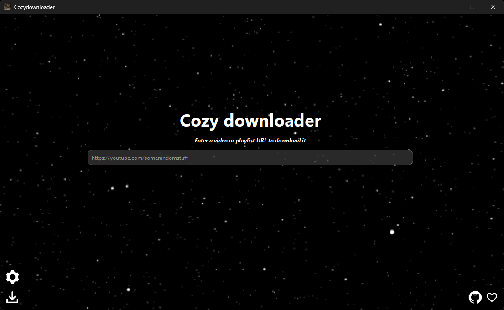
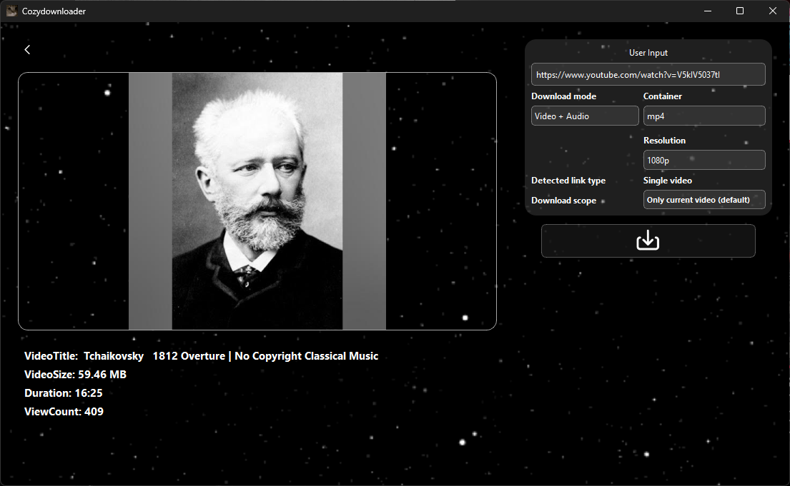
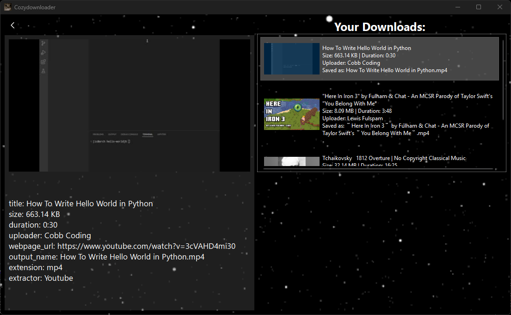
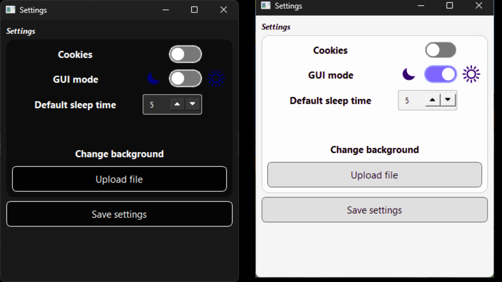

# Cozydownloader

### Front-end application for [yt-dlp](https://github.com/yt-dlp/yt-dlp)
- #### For downloading media(videos, audios) from diferent websites ⬇️🎥  
- #### Windows only(10 or above)

### Features
- Easy to use
- Supports various popular websites(youtube, twitch, Facebook, etc..)
- Selectable video resolution   
- Playlist support(YouTube)
- Download preview
- Settings supported
- Cookie supported
- Download history
### Screenshots

    

### Requirements
- [**FFmpeg**](https://ffmpeg.org/download.html#build-windows)
- [**yt-dlp**](https://github.com/yt-dlp/yt-dlp)
- [**Pyside6**](https://pypi.org/project/PySide6/)
- [**Python 3**](https://www.python.org/downloads/)
### Installer
[**Cozydownloader-installer**](https://github.com/cozidesire/cozydownloader/releases/tag/v1.0.0) <- An automatic installer for the Cozydownloader app and its dependencies
### Authors
- Cosidesire([cosidesire](https://github.com/cozidesire))

For any suggestions, comments or questions let me know via [Discussions](https://github.com/cozidesire/cozydownloader/discussions) and for issues via [Issues](https://github.com/cozidesire/cozydownloader/issues)
